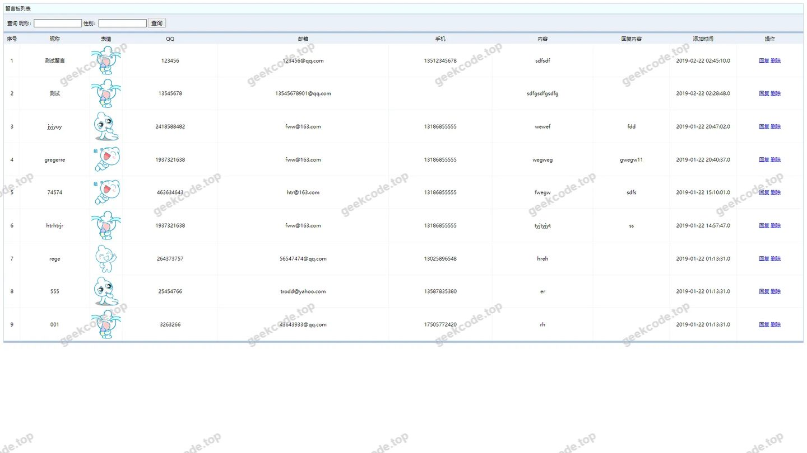
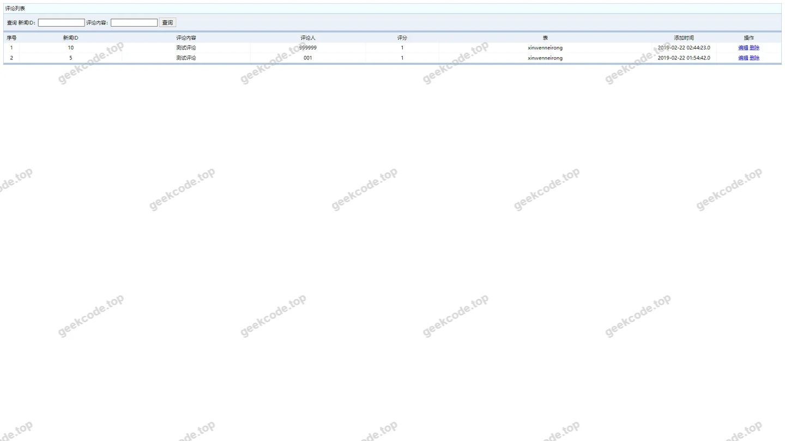
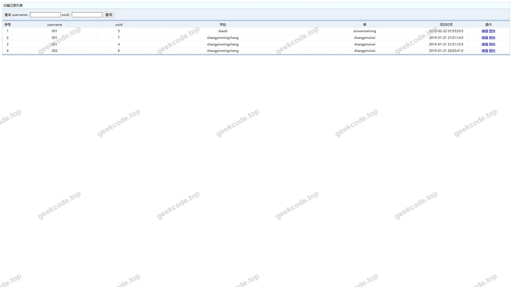
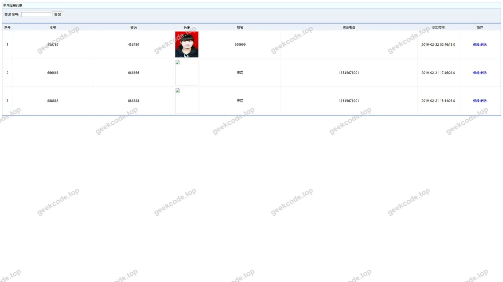
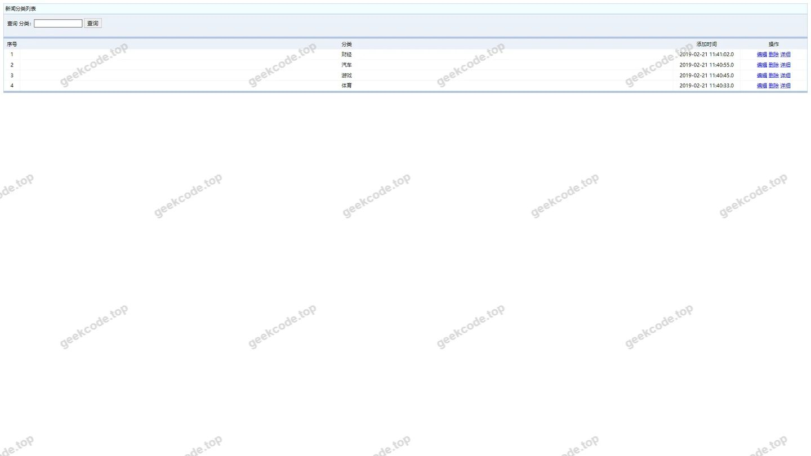
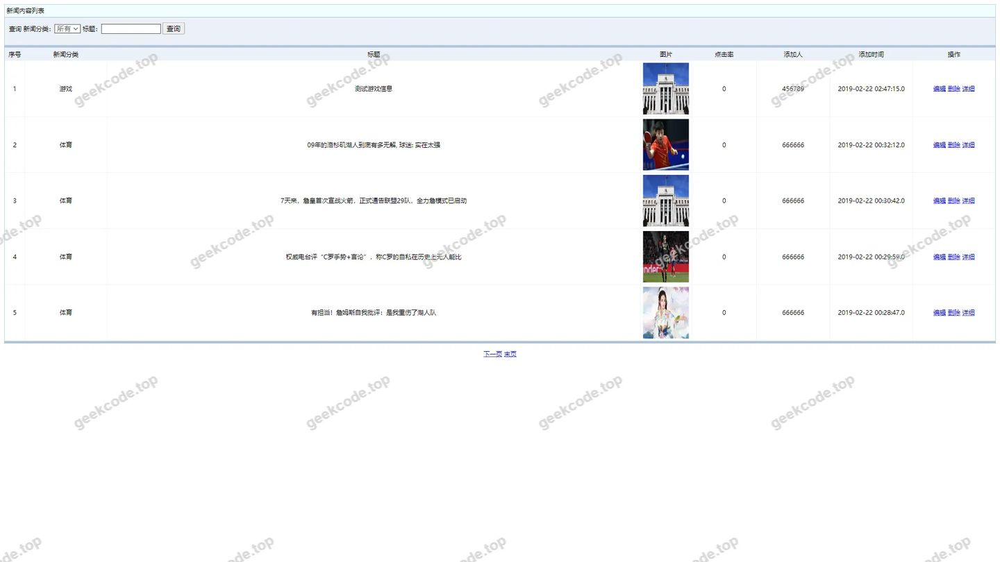
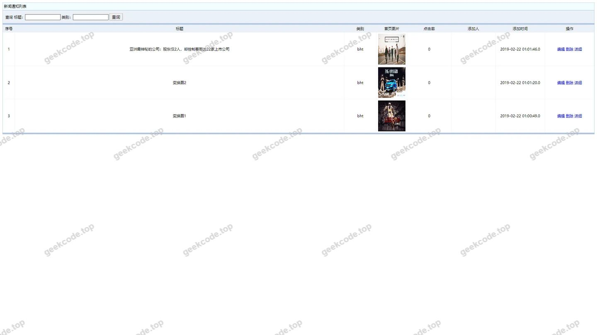
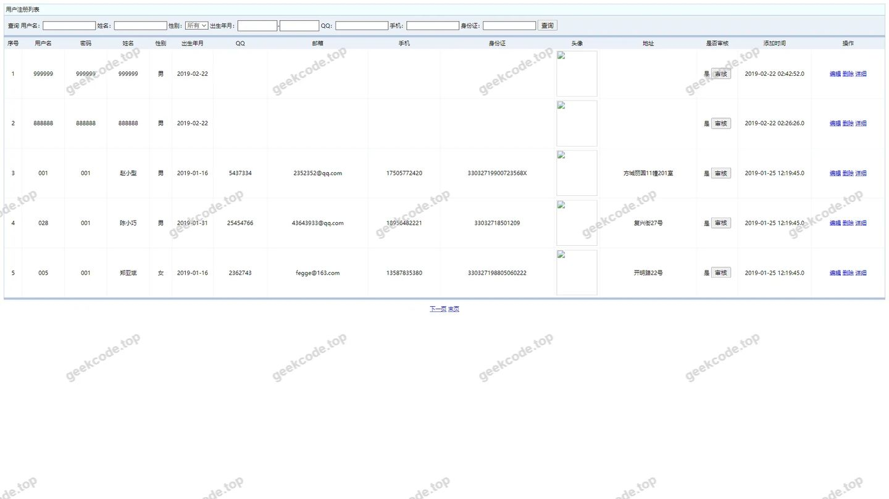
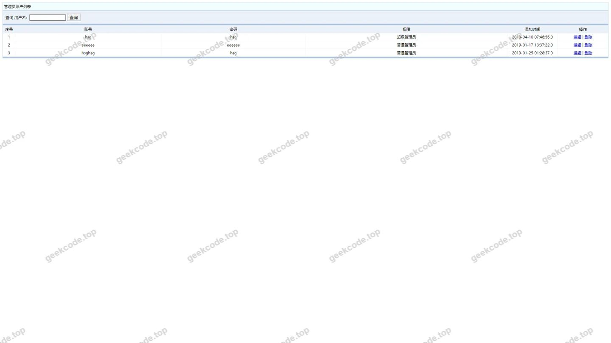

# ssm新闻管理系统hsg3820程序

> 🎓 **计算机毕业设计 · ssm新闻管理系统hsg3820程序**
>
> 本仓库只放**项目介绍 + 运行截图**（截图是站点带水印的原图，存在仓库 `images/` 里）。
>
> 👉 **完整可运行源码 / 数据库脚本 / 部署文档：[点我获取](https://geekcode.top/archives/ssm%E6%96%B0%E9%97%BB%E7%AE%A1%E7%90%86%E7%B3%BB%E7%BB%9Fhsg3820%E7%A8%8B%E5%BA%8F?utm_source=github)**
>
> 💬 咨询微信：**ir9372**　|　🌐 更多项目：[极客代码 geekcode.top](https://geekcode.top/?utm_source=github)
>
> 📌 项目详情页：<https://geekcode.top/archives/ssm%E6%96%B0%E9%97%BB%E7%AE%A1%E7%90%86%E7%B3%BB%E7%BB%9Fhsg3820%E7%A8%8B%E5%BA%8F?utm_source=github>

<table><td width="230" align="center"> <b>扫码加微信 ir9372</b></td><td valign="middle">📦 源码 = 项目介绍 + 全部运行截图 + 数据库 + 部署文档 👉 点上方任意截图，直接跳到 <b>极客代码 geekcode.top</b> 详情页</td></table>

---

<h1>ssm新闻管理系统hsg3820程序</h1>
<h2>项目概述</h2>

本项目名为“ssm新闻管理系统hsg3820程序”，是一个基于SSM（Spring+Spring MVC+MyBatis）框架与JSP技术构建的新闻内容管理与展示系统。该项目旨在为新闻站点提供一套标准化的后台管理解决方案，实现从新闻分类、内容发布到用户互动的全流程数字化管理。核心功能涵盖新闻内容的增删改查、留言反馈处理、收藏记录管理及友情链接维护等。适用人群主要为需要快速搭建新闻门户或资讯站点的中小型机构及个人开发者。技术架构采用经典的Java Web三层架构模式，通过MVC设计思想分离业务逻辑、数据访问与视图呈现，确保系统的可维护性与扩展性。尽管项目标记为无前台导航及特定路由配置，但其截图列表明确展示了包括用户注册、新闻发布、评论管理等在内的完整业务闭环页面，体现了其作为综合性新闻管理平台的核心价值。

<h2>技术架构</h2>

本系统采用成熟的SSM框架组合进行开发，具体技术选型及架构设计如下：

<ol>
<li><strong>后端架构</strong>：</li>
</ol>
<ul>
<li><strong>Spring</strong>：作为核心容器，负责Bean的生命周期管理、依赖注入（DI）及面向切面编程（AOP），简化了业务逻辑组件的配置与管理。</li>
<li><strong>Spring MVC</strong>：处理Web层的请求分发与控制，通过Controller层接收HTTP请求，调用Service层业务逻辑，并返回ModelAndView或JSON数据至前端。</li>
<li><strong>MyBatis</strong>：作为持久层框架，通过XML映射文件或注解将SQL语句与Java方法绑定，实现对MySQL数据库的高效操作，支持动态SQL生成，降低了JDBC代码的冗余度。</li>
</ul>
<ol start="2">
<li><strong>前端技术</strong>：</li>
</ol>
<ul>
<li><strong>JSP (JavaServer Pages)</strong>：用于生成动态网页内容，结合Servlet技术实现服务端渲染。页面中嵌入Java代码片段以处理显示逻辑，利用HTML/CSS/JavaScript构建用户界面。</li>
</ul>
<ol start="3">
<li><strong>数据库设计要点</strong>：</li>
</ol>
<ul>
<li>基于截图中的功能模块推断，数据库主要包含以下实体表结构：</li>
<li><code>allusers</code> / <code>yonghuzhuce</code>：存储用户基本信息及注册状态。</li>
<li><code>xinwenfenlei</code>：定义新闻的分类体系。</li>
<li><code>xinwenfabu</code> / <code>xinwenneirong</code>：存储新闻标题、正文、发布时间及关联分类ID。</li>
<li><code>pinglun</code>：记录用户对新闻的评论内容及时间。</li>
<li><code>liuyanban</code>：独立于新闻评论的通用留言板数据。</li>
<li><code>shoucangjilu</code>：追踪用户的收藏行为。</li>
<li><code>youqinglianjie</code>：维护外部链接资源。</li>
<li>各表之间通过外键关联，例如新闻内容表通过<code>fenlei_id</code>关联分类表，评论表通过<code>news_id</code>关联新闻表，确保数据的一致性与完整性。</li>
</ul>
<ol start="4">
<li><strong>核心技术选型理由</strong>：</li>
</ol>
<ul>
<li>SSM框架是Java企业级应用开发的经典标准，社区资源丰富，文档完善，适合毕业设计场景下的稳定性要求。</li>
<li>JSP技术无需复杂的构建工具链，部署简单，便于初学者理解Web请求响应流程。</li>
</ul>
<h2>功能模块</h2>

根据提供的截图功能列表，系统将功能划分为以下主要模块。由于项目未明确区分前台与后台路由，且标记为“无前台”、“无后台”，以下按业务逻辑归类：

<h3>1. 用户管理模块</h3>
<ul>
<li><strong>用户注册 (<code>yonghuzhuce</code>)</strong>：提供新用户创建账号的功能，收集基本身份信息。</li>
<li><strong>用户列表管理 (<code>allusers</code>)</strong>：管理员可查看系统中所有注册用户的信息列表。</li>
<li><strong>用户信息修改 (<code>allusersupdt</code>)</strong>：允许更新特定用户的个人资料或权限设置。</li>
</ul>
<h3>2. 新闻内容管理模块</h3>
<ul>
<li><strong>新闻分类管理 (<code>xinwenfenlei</code>)</strong>：对新闻所属类别进行增删改查操作，如国际、国内、科技等。</li>
<li><strong>新闻发布管理 (<code>xinwenfabu</code>)</strong>：编辑和保存新发布的新闻条目，关联对应的分类。</li>
<li><strong>新闻内容详情 (<code>xinwenneirong</code>)</strong>：查看、编辑或删除已发布新闻的具体正文内容。</li>
<li><strong>新闻通知管理 (<code>xinwentongzhi</code>)</strong>：发布系统公告或新闻相关的通知消息。</li>
</ul>
<h3>3. 互动与反馈模块</h3>
<ul>
<li><strong>评论管理 (<code>pinglun</code>)</strong>：查看和管理用户对新闻文章发表的评论，支持审核或删除违规内容。</li>
<li><strong>留言板管理 (<code>liuyanban</code>)</strong>：处理用户提交的站内留言，提供回复或删除功能。</li>
<li><strong>收藏记录管理 (<code>shoucangjilu</code>)</strong>：查看用户的收藏历史，可能涉及收藏项的管理或统计。</li>
</ul>
<h3>4. 系统基础配置模块</h3>
<ul>
<li><strong>友情链接管理 (<code>youqinglianjie</code>)</strong>：维护网站底部的合作伙伴或推荐链接列表。</li>
<li><strong>登录页 (<code>other</code>)</strong>：系统入口，验证用户身份（管理员或普通用户）。</li>
<li><strong>编辑页面 (<code>admin</code>)</strong>：通用的后台编辑界面，用于上述各模块数据的详细录入与修改。</li>
</ul>
<h2>用户角色与权限</h2>

基于SSM新闻管理系统的典型设计及截图所示的“admin”编辑页面，系统主要包含两类角色：

<h3>1. 超级管理员 (Admin)</h3>
<ul>
<li><strong>权限描述</strong>：拥有系统的最高控制权，负责整体运营与维护。</li>
<li><strong>可访问功能模块</strong>：</li>
<li><strong>用户管理</strong>：查看所有用户列表 (<code>allusers</code>)，修改用户信息 (<code>allusersupdt</code>)。</li>
<li><strong>内容审核与发布</strong>：完全控制新闻分类 (<code>xinwenfenlei</code>)、新闻发布 (<code>xinwenfabu</code>)、新闻内容 (<code>xinwenneirong</code>) 及通知 (<code>xinwentongzhi</code>) 的新建、编辑和删除。</li>
<li><strong>互动管理</strong>：管理所有评论 (<code>pinglun</code>)、留言 (<code>liuyanban</code>) 及收藏记录 (<code>shoucangjilu</code>)，具备删除不当内容的权限。</li>
<li><strong>系统配置</strong>：维护友情链接 (<code>youqinglianjie</code>) 及其他全局设置。</li>
<li><strong>登录</strong>：通过登录页进入后台管理界面。</li>
</ul>
<h3>2. 普通用户 (User)</h3>
<ul>
<li><strong>权限描述</strong>：系统的主要使用者，侧重于内容消费与互动。</li>
<li><strong>可访问功能模块</strong>：</li>
<li><strong>账户管理</strong>：执行用户注册 (<code>yonghuzhuce</code>) 操作，创建个人账户。</li>
<li><strong>内容浏览</strong>：查看已发布的新闻内容及分类信息（虽截图未直接展示前台浏览页，但这是新闻系统的基础功能）。</li>
<li><strong>互动参与</strong>：在新闻页面发表评论 (<code>pinglun</code>)，在留言板提交留言 (<code>liuyanban</code>)，以及添加新闻到收藏夹 (<code>shoucangjilu</code>)。</li>
<li><strong>注意</strong>：根据现有截图列表，普通用户无法直接访问后台管理类页面（如<code>allusers</code>列表或<code>admin</code>编辑页），其操作产生的数据最终由管理员在后台进行管理。</li>
</ul>
<h2>项目特色与创新点</h2>
<ol>
<li>
<strong>全链路内容闭环管理</strong>：
   项目不仅涵盖了传统的新闻发布与分类管理，还集成了深度的用户互动机制。通过<code>pinglun</code>（评论）、<code>liuyanban</code>（留言）和<code>shoucangjilu</code>（收藏）三个独立模块，构建了从“阅读-反馈-留存”的用户行为闭环，提升了平台的用户粘性。

</li>
<li>
<strong>模块化数据结构设计</strong>：
   将新闻主体（<code>xinwenfabu</code>/<code>xinwenneirong</code>）与元数据（<code>xinwenfenlei</code>）、附加信息（<code>xinwentongzhi</code>）分离，使得系统在处理大量新闻数据时具有良好的扩展性。同时，独立的<code>youqinglianjie</code>模块便于SEO优化和资源引流。

</li>
<li>
<strong>经典稳健的技术栈</strong>：
   选用SSM+JSP组合，避免了现代前端框架（如Vue/React）带来的构建复杂性，更适合教学演示及小型项目的快速迭代。其分层架构清晰，利于学生理解和掌握Java Web开发的核心原理。

</li>
<li>
<strong>直观的后台可视化操作</strong>：
   通过<code>allusers</code>、<code>xinwenfabu</code>等列表页与<code>admin</code>编辑页的配合，提供了标准的CRUD（增删改查）交互体验，管理员无需编写SQL即可高效完成日常运营工作。

</li>
</ol>
<h2>部署环境</h2>

为确保“ssm新闻管理系统hsg3820程序”正常运行，需准备以下软件环境：

<ol>
<li><strong>操作系统</strong>：</li>
</ol>
<ul>
<li>Windows 7/10/11 或 Linux (CentOS/Ubuntu)。</li>
</ul>
<ol start="2">
<li><strong>开发工具与运行时</strong>：</li>
</ol>
<ul>
<li><strong>JDK</strong>：建议版本 JDK 1.8 或以上，用于编译和运行Java代码。</li>
<li><strong>IDE</strong>：IntelliJ IDEA 或 Eclipse，用于代码编辑、调试及项目管理。</li>
<li><strong>Maven</strong>：用于依赖管理和项目构建（若项目使用pom.xml）。</li>
</ul>
<ol start="3">
<li><strong>Web服务器</strong>：</li>
</ol>
<ul>
<li><strong>Tomcat</strong>：建议版本 Apache Tomcat 8.5 或 9.0，用于部署WAR包并解析JSP页面。</li>
</ul>
<ol start="4">
<li><strong>数据库</strong>：</li>
</ol>
<ul>
<li><strong>MySQL</strong>：建议版本 MySQL 5.7 或 8.0，用于存储新闻、用户及互动数据。需配置相应的用户名、密码及端口号。</li>
<li><strong>数据库驱动</strong>：MySQL Connector/J。</li>
</ul>
<ol start="5">
<li><strong>浏览器</strong>：</li>
</ol>
<ul>
<li>Chrome, Firefox, Edge 等主流浏览器，用于访问系统前端页面及后台管理界面。</li>
</ul>
<h2>五、技术特性</h2>
<ul>
<li>服务端模板渲染（JSP）</li>
</ul>
<h2>六、功能模块截图</h2>
<h3>前台用户端</h3>
<h4>页面-liuyanban列表</h4>

<h4>页面-pinglun列表</h4>

<h4>页面-shoucangjilu列表</h4>

<h4>页面-xinwenfabu列表</h4>

<h4>页面-xinwenfenlei列表</h4>

<h4>页面-xinwenneirong列表</h4>

<h4>页面-xinwentongzhi列表</h4>

<h4>页面-yonghuzhuce列表</h4>

<h4>页面-youqinglianjie列表</h4>

<h4>页面-allusersupdt</h4>

<h4>页面-编辑</h4>

<h3>后台管理端</h3>
<h4>登录页</h4>

<h4>页面-allusers列表</h4>

---

## 获取完整源码

| 项目 | 说明 |
| --- | --- |
| 项目名 | ssm新闻管理系统hsg3820程序 |
| 运行截图 | 本文 13 张（站点带水印原图，仓库 `images/` 目录） |
| 完整源码 | [https://geekcode.top/archives/ssm%E6%96%B0%E9%97%BB%E7%AE%A1%E7%90%86%E7%B3%BB%E7%BB%9Fhsg3820%E7%A8%8B%E5%BA%8F?utm_source=github](https://geekcode.top/archives/ssm%E6%96%B0%E9%97%BB%E7%AE%A1%E7%90%86%E7%B3%BB%E7%BB%9Fhsg3820%E7%A8%8B%E5%BA%8F?utm_source=github) |
| 咨询微信 | **ir9372**（备注：jingpin-yuanma） |
| 更多项目 | [极客代码 geekcode.top](https://geekcode.top/?utm_source=github) |

> 需要源码、部署、改配置、跑不起来等问题，加微信 ir9372 沟通，说明项目名即可。
